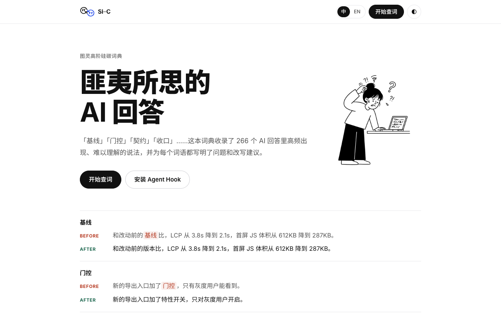
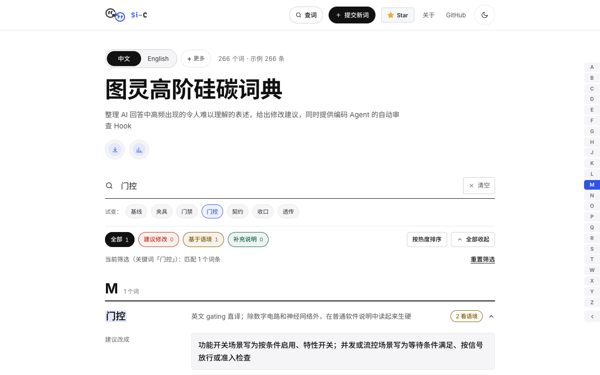
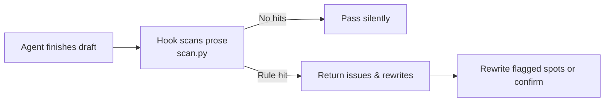

<div align="center">
  
  <h1>Turing Advanced Silicon–Carbon Dictionary</h1>
  <p>Catalogs vague, overused phrasing and jargon common in AI responses, explains why each term is unclear, and suggests concrete alternatives—alongside dictionary web pages and an automatic review hook for coding agents. Currently focused on Chinese (<code>rules/zh.yaml</code>), with multi-language structure reserved in <code>rules/</code> and <code>locales/</code> (contributions welcome).</p>

  <p>
    <a href="https://github.com/Slone123c/turing-advanced-silicon-carbon-dictionary/stargazers"></a>
    <a href="LICENSE"></a>
    
    
    
  </p>

  <p>
    <a href="README.md">中文</a> ·
    <strong>English</strong> ·
    <a href="https://slone123c.github.io/turing-advanced-silicon-carbon-dictionary/intro/">About</a> ·
    <a href="https://slone123c.github.io/turing-advanced-silicon-carbon-dictionary/?lang=en">Live Dictionary</a> ·
    <a href="https://slone123c.github.io/turing-advanced-silicon-carbon-dictionary/replay/result.html">Rewrite Comparison</a> ·
    <a href="https://github.com/Slone123c/turing-advanced-silicon-carbon-dictionary/issues/new?labels=new-term&title=%5BNew+Term%5D+">Submit a Term</a>
  </p>
</div>

<p align="center">
  <a href="https://slone123c.github.io/turing-advanced-silicon-carbon-dictionary/intro/">
    <picture>
      <source media="(prefers-color-scheme: dark)" srcset="docs/assets/about-dark.png" />
      <source media="(prefers-color-scheme: light)" srcset="docs/assets/about-light.png" />
      
    </picture>
  </a>
</p>

<p align="center">
  <a href="https://slone123c.github.io/turing-advanced-silicon-carbon-dictionary/?lang=en">
    <picture>
      <source media="(prefers-color-scheme: dark)" srcset="docs/assets/preview-dark.png" />
      <source media="(prefers-color-scheme: light)" srcset="docs/assets/preview-light.png" />
      
    </picture>
  </a>
</p>

## Hook Wording Review

When an agent finishes a reply, the hook intercepts the draft and runs `scan.py` on plain prose (skipping code blocks, inline code, links, and quoted text). Clean replies pass silently. If a rule matches, the hook sends the issue and suggested rewrites back to the agent so it can either edit only the flagged spots or reply `[Wording confirmed, keep original]` (or the matching locale marker) if the context justifies keeping it. Each reply is checked at most once; re-generation on hits may slightly increase token usage.



| Before (Intercepted Draft) | After (Hook Rewrite) |
| --- | --- |
| "Let’s delve into how we can leverage this seamless, robust pipeline." | "Let’s look at how the worker queue retries failed jobs automatically without manual restarts." |

### Let Your Agent Install It

Send this prompt to your coding agent—it handles both built-in targets and unsupported agents:

```text
Install the Turing Advanced Silicon–Carbon Dictionary wording-check hook for your current agent:
1. Locate this repo locally (or clone https://github.com/Slone123c/turing-advanced-silicon-carbon-dictionary.git) and make sure Python 3 and pyyaml are available.
2. Run `python3 install.py --list` in the repo root to identify your `--target`. If supported, install via `python3 install.py --target <target>` and verify the status.
3. If your agent is not listed, inspect your own hook/extension specification (look for a turn-end event like Stop, AfterAgent, turn_end, or session.idle), check `adapters/` and `examples/hooks/` for reference, and merge a hook entry without overwriting existing config that runs `python3 <repo_abs_path>/scan.py --hook claude-code` (wrap payload fields in a small script if your schema differs).
4. Tell me which file you modified and whether a new session is required.
```

### Manual Installation

Requires Python 3 and PyYAML (`pip install pyyaml`). `install.py` merges entries idempotently, creates backups before editing, and only removes its own entries on uninstall. Changes take effect in new sessions.

```bash
python3 install.py --list                         # Check status for all targets
python3 install.py                                # Install for all detected agents
python3 install.py --target claude codex cursor   # Install specific targets (--force-grok forces Grok native file)
python3 install.py --uninstall                    # Remove only entries added by this tool (supports --target)
```

<details>
<summary><strong>View all 16 supported agents & hook locations</strong> (manual config examples in <code>examples/hooks/</code>)</summary>

<br />

| Target | `--target` | Config Location | Notes |
| --- | --- | --- | --- |
| Claude Code | `claude` | `~/.claude/settings.json` → `Stop` | Native `Stop` hook |
| Codex | `codex` | `~/.codex/hooks.json` → `Stop` | `Stop` hook, Claude-compatible schema |
| Cursor | `cursor` | `~/.cursor/hooks/turing-advanced-silicon-carbon-dictionary.sh` + `hooks.json` | Wrapper script: stashes `afterAgentResponse`, reviews on `stop` |
| Grok | `grok` | Uses Claude settings by default; or `~/.grok/hooks/…` (`--force-grok`) | Skips automatically if Claude is already installed |
| OMP | `omp` | `~/.omp/agent/extensions/turing-advanced-silicon-carbon-dictionary.ts` | Standalone `session_stop` extension |
| Gemini CLI | `gemini` | `~/.gemini/settings.json` → `AfterAgent` | Denies on hit to request rewrite (10s timeout) |
| Antigravity | `antigravity` | `~/.gemini/config/hooks.json` → `Stop` | Reads last response from `transcriptPath`; continues on hit |
| Qwen Code | `qwen` | `~/.qwen/settings.json` → `Stop` | `Stop` hook, Claude-compatible schema |
| CodeBuddy | `codebuddy` | `~/.codebuddy/settings.json` → `Stop` | Claude-compatible `Stop` hook |
| Qoder | `qoder` | `~/.qoder/settings.json` → `Stop` | Claude-compatible `Stop` hook |
| Trae / Trae CN | `trae` | `~/.trae/hooks.json` (and `~/.trae-cn/hooks.json`) → `Stop` | Flat `Stop` entry with `loop_limit: 2` |
| GitHub Copilot CLI | `copilot` | `~/.copilot/hooks/turing-advanced-silicon-carbon-dictionary.json` | Standalone `agentStop` config (10s timeout) |
| Kiro | `kiro` | `~/.kiro/hooks/turing-advanced-silicon-carbon-dictionary.json` | Standalone `Stop` config |
| Pi | `pi` | `~/.pi/agent/extensions/turing-advanced-silicon-carbon-dictionary.ts` | `turn_end` extension |
| OpenCode | `opencode` | `~/.config/opencode/plugins/turing-advanced-silicon-carbon-dictionary.js` | `session.idle` plugin (V1 & V2 compatible) |
| DeepSeek Harness | `dsh` | `~/.dsh/profiles/*/turing-advanced-silicon-carbon-dictionary.mjs` + `cordis.patch.yml` | Cordis plugin listening on `agent/turn-stopping` |

</details>

## CLI Scanning & Rules

Scan files directly, run as a hook, or inspect logs (run `python3 <script> --help` for full options):

```bash
python3 scan.py draft.md                      # Scan file (use - for stdin); exits 1 if rewrite hits exist
python3 scan.py --json draft.md               # Output structured JSON hits
python3 scan.py --lang en draft.md            # Force prompt/output language (auto-detected by default)
python3 scan.py --no-user-rules draft.md      # Ignore ~/.sic-dict/rules/ and use built-in rules only
python3 scan.py --hook <agent>                # Run as an agent hook (reads event JSON from stdin)
python3 scan.py --stats [--all]               # Summarize fixed/kept rates (--all includes archived)
python3 scan.py --log [TERM] [--limit 30]     # Inspect hit contexts and outcomes (--archive [TS] to archive)
python3 scan.py --understood                  # List locally confirmed level-3 terms
python3 scan.py --confirm-understood [TERM..] # Mark level-3 terms as understood (--note "explanation")
python3 scan.py --test [--lang zh|en]         # Validate rule files and tests/cases.yaml
```

Rules are grouped into 4 levels (not a hard ban list—final judgment stays with the AI):

| Level | Meaning | Expected AI Behavior |
| --- | --- | --- |
| `1` | Prefer rewrite | Replace with concrete wording by default; keep only for quotes, user-introduced terms, or proper nouns |
| `2` | Check context | Judge against `ok_when` / `bad_when`; keep if clear to the reader |
| `3` | Explain if needed | Term is fine; briefly explain on first mention if readers might not know it |
| `0` | Allow | Ignored; used to override false-positive substring matches |

<details>
<summary><strong>Custom allowlists, overrides, other scripts & repository map</strong></summary>

<br />

### Custom Allowlists & Overrides

- **Project allowlist**: Add `.sic-dict.yaml` at the project root with `allow: [term, ...]` to allow those terms in that project.
- **User overrides**: Place YAML files (e.g. `en.yaml`, `zh.yaml`) in `~/.sic-dict/rules/` (or `$SIC_DICT_HOME/rules/`). Matching `term` entries replace built-in rules; new entries are appended. Pass `--no-user-rules` to ignore user overrides temporarily.

```yaml
# ~/.sic-dict/rules/en.yaml example: allow "leverage"
lang: en
rules:
  0:
  - term: leverage
```

### Other Scripts

All entry scripts support `--help`; `.py` files under `adapters/` and `tests/` are modules and test suites rather than standalone CLIs:

```bash
python3 build_site.py [--repo owner/name]                   # Build web/src/rules.json from rules/*.yaml
python3 replay/replay.py <backend> [...] [--cases ...]      # Run multi-round rewrite replays into replay/results/
python3 replay/render.py [--cases ...] [--out ...]          # Render replay/results/*.json into docs/replay/result.html
python3 -m unittest discover -s tests                       # Run all unit tests and rule cases
```

### Repository Map

- `rules/`: Rule definitions by language (`zh.yaml`, `en.yaml`)
- `locales/`: Prompt and feedback templates by language (`zh.yaml`, `en.yaml`)
- `docs/`, `web/`: Static dictionary page and React frontend
- `replay/`: Multi-model replay cases (`cases.json`) and saved outputs (`results/`)
- `adapters/`, `templates/`, `examples/hooks/`: Agent adapters, extension templates, and hook config examples
- `tests/`: Rule test cases (`cases.yaml`) and unit tests

</details>

## Contributing

- [Submit a term or false positive (Issue)](https://github.com/Slone123c/turing-advanced-silicon-carbon-dictionary/issues/new?labels=new-term&title=%5BNew+Term%5D+)
- Edit `rules/zh.yaml` (or `rules/en.yaml`), run `python3 scan.py --test`, and open a PR

## Star History

<a href="https://www.star-history.com/#Slone123c/turing-advanced-silicon-carbon-dictionary&Date">
 <picture>
   <source media="(prefers-color-scheme: dark)" srcset="https://api.star-history.com/svg?repos=Slone123c/turing-advanced-silicon-carbon-dictionary&type=Date&theme=dark" />
   <source media="(prefers-color-scheme: light)" srcset="https://api.star-history.com/svg?repos=Slone123c/turing-advanced-silicon-carbon-dictionary&type=Date" />
   
 </picture>
</a>

## License

[MIT License](LICENSE)

---

<sub>Name inspired by the Oxford Advanced Learner's Dictionary</sub>
