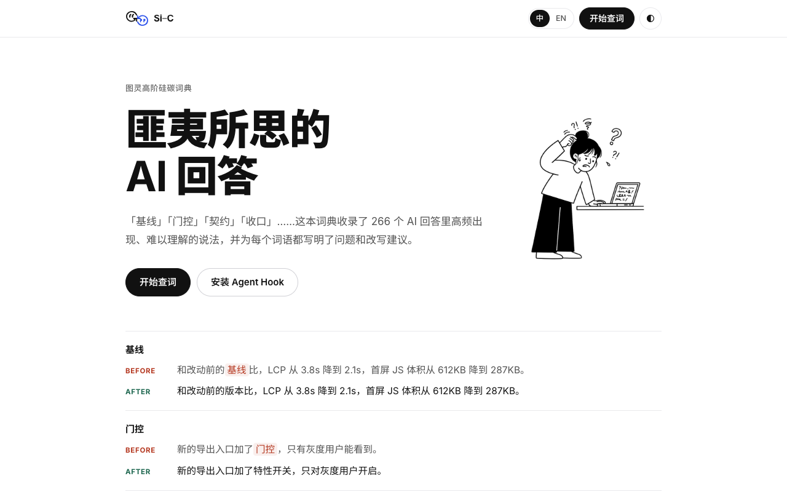
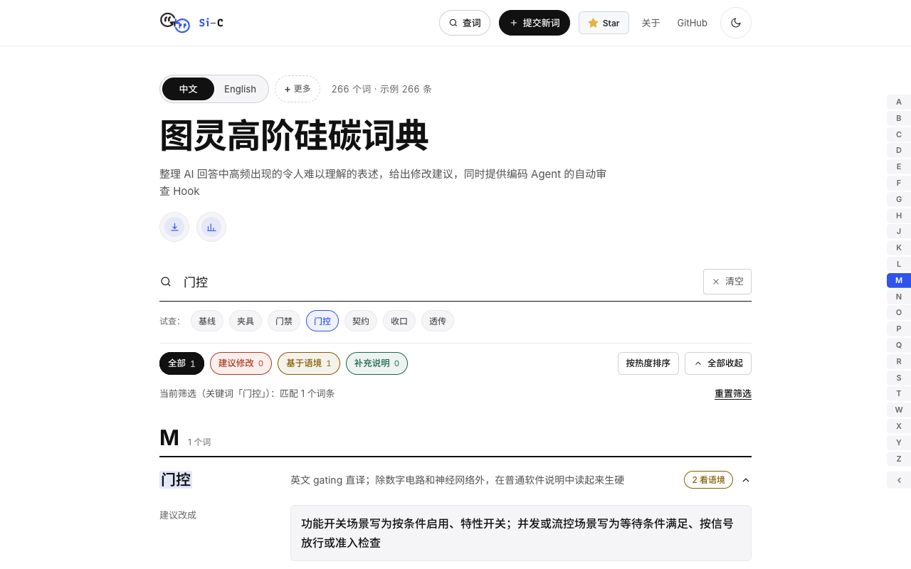
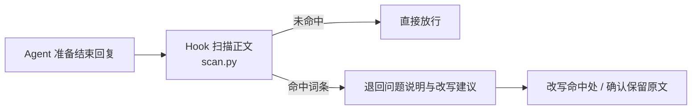

<div align="center">
  
  <h1>Turing Advanced Silicon–Carbon Dictionary</h1>
  <p>图灵高阶硅碳词典。整理 AI 回答中高频出现的令人难以理解的表述，并给出修改建议。提供 Agent 的自动审查 Hook。目前以中文为主（其他语言已在 <code>rules/</code> 中做好预留，欢迎补充）。</p>

  <p>
    <a href="https://github.com/Slone123c/turing-advanced-silicon-carbon-dictionary/stargazers"></a>
    <a href="LICENSE"></a>
    
    
    
  </p>

  <p>
    <strong>中文</strong> ·
    <a href="README.en.md">English</a> ·
    <a href="https://slone123c.github.io/turing-advanced-silicon-carbon-dictionary/intro/">关于</a> ·
    <a href="https://slone123c.github.io/turing-advanced-silicon-carbon-dictionary/">在线词典</a> ·
    <a href="https://slone123c.github.io/turing-advanced-silicon-carbon-dictionary/replay/result.html">改写对比</a> ·
    <a href="https://github.com/Slone123c/turing-advanced-silicon-carbon-dictionary/issues/new?labels=new-term&title=%5B%E6%96%B0%E8%AF%8D%E6%9D%A1%5D+">提交新词</a>
  </p>
</div>

<p align="center">
  <a href="https://slone123c.github.io/turing-advanced-silicon-carbon-dictionary/intro/">
    <picture>
      <source media="(prefers-color-scheme: dark)" srcset="docs/assets/about-dark.png" />
      <source media="(prefers-color-scheme: light)" srcset="docs/assets/about-light.png" />
      
    </picture>
  </a>
</p>

<p align="center">
  <a href="https://slone123c.github.io/turing-advanced-silicon-carbon-dictionary/">
    <picture>
      <source media="(prefers-color-scheme: dark)" srcset="docs/assets/preview-dark.png" />
      <source media="(prefers-color-scheme: light)" srcset="docs/assets/preview-light.png" />
      
    </picture>
  </a>
</p>

## Hook 措辞审查

在 Agent 准备结束回复时自动拦截并检查正文（跳过代码块、行内代码、链接和成对引号内的引用）。没命中直接放行；命中则把问题说明和改写建议退回给 Agent 自查——确有更好说法就只改命中处，语境合理就回复「`【措辞已确认，保留原文】`」，每条回复最多拦一次。由于命中后需要重新回复，可能会造成 token 用量略微增加。



| 拦截前（AI 原回复） | 改写后（Hook 退回自查） |
| --- | --- |
| 「账本 15/15 全绿，我在这里再补一刀，先把这块收口，跟上游对齐一下。」 | 「15 项测试全部通过。我在解析层补了空值判断，报错统一由 `authErrors.ts` 处理，再和上游核对字段格式。」 |

### 让 Agent 自行安装

把下面这段话直接发给正在用的编码 Agent，支持列表里的端会自动装好，不在列表里的也会自行查规范接入：

```text
帮我安装 Turing Advanced Silicon–Carbon Dictionary 的措辞检查 Hook：
1. 确认本机已有这个仓库（没有的话先克隆 https://github.com/Slone123c/turing-advanced-silicon-carbon-dictionary.git），并确保 Python 3 和 pyyaml 可用。
2. 在仓库目录跑 `python3 install.py --list`，确认你自己对应哪个 `--target`；在列表里就直接用 `python3 install.py --target <target>` 安装并核对状态。
3. 如果你不在支持列表里，先查一下自己的 Hook 或扩展规范（找回答结束事件，比如 Stop、AfterAgent、turn_end、session.idle），参考仓库里的 `adapters/` 和 `examples/hooks/`，在不覆盖现有配置的前提下合并写入一条调用 `python3 <仓库绝对路径>/scan.py --hook claude-code` 的 Hook（格式不一致就写个小脚本转换字段）。
4. 装完告诉我改了哪个文件，以及要不要新开会话生效。
```

### 手动安装

需要 Python 3 和 PyYAML（`pip install pyyaml`）。`install.py` 会合并写入、可安全重复执行，改动前自动备份，卸载时只删本工具写入的条目，安装后新开会话生效。

```bash
python3 install.py --list                         # 查看各端状态
python3 install.py                                # 安装到检测到的全部目标
python3 install.py --target claude codex cursor   # 只装指定端（Grok 强制写独立配置加 --force-grok）
python3 install.py --uninstall                    # 只卸本工具写入的条目（可配合 --target）
```

<details>
<summary><strong>展开查看全部 16 个已支持客户端与写入位置</strong>（手动配置样例见 <code>examples/hooks/</code>）</summary>

<br />

| 目标 | `--target` | 写入位置 | 说明 |
| --- | --- | --- | --- |
| Claude Code | `claude` | `~/.claude/settings.json` → `Stop` | 原生 `Stop` 钩子 |
| Codex | `codex` | `~/.codex/hooks.json` → `Stop` | `Stop` 钩子，格式同 Claude |
| Cursor | `cursor` | `~/.cursor/hooks/turing-advanced-silicon-carbon-dictionary.sh` + `hooks.json` | `afterAgentResponse` 暂存回复，`stop` 时检查并追改 |
| Grok | `grok` | 默认复用 Claude；或 `~/.grok/hooks/…`（`--force-grok`） | 已装 Claude 时自动跳过，避免双触发 |
| OMP | `omp` | `~/.omp/agent/extensions/turing-advanced-silicon-carbon-dictionary.ts` | `session_stop` 独立扩展，不改已有扩展 |
| Gemini CLI | `gemini` | `~/.gemini/settings.json` → `AfterAgent` | 需改写时拒绝并要求重答（超时 10s） |
| Antigravity | `antigravity` | `~/.gemini/config/hooks.json` → `Stop` | 读 `transcriptPath` 里最后一条回复，需改写时续跑提示 |
| Qwen Code | `qwen` | `~/.qwen/settings.json` → `Stop` | `Stop` 钩子，格式同 Claude |
| CodeBuddy | `codebuddy` | `~/.codebuddy/settings.json` → `Stop` | 兼容 Claude 规范 |
| Qoder | `qoder` | `~/.qoder/settings.json` → `Stop` | 兼容 Claude 规范 |
| Trae / Trae CN | `trae` | `~/.trae/hooks.json`（及 `~/.trae-cn/hooks.json`）→ `Stop` | 扁平 `Stop` 条目，带 `loop_limit: 2` 防循环 |
| GitHub Copilot CLI | `copilot` | `~/.copilot/hooks/turing-advanced-silicon-carbon-dictionary.json` | `agentStop` 独立配置（超时 10s） |
| Kiro | `kiro` | `~/.kiro/hooks/turing-advanced-silicon-carbon-dictionary.json` | 独立 `Stop` 配置 |
| Pi | `pi` | `~/.pi/agent/extensions/turing-advanced-silicon-carbon-dictionary.ts` | `turn_end` 回合结束扩展 |
| OpenCode | `opencode` | `~/.config/opencode/plugins/turing-advanced-silicon-carbon-dictionary.js` | `session.idle` 插件，兼容 V1/V2 接口 |
| DeepSeek Harness | `dsh` | `~/.dsh/profiles/*/turing-advanced-silicon-carbon-dictionary.mjs` + `cordis.patch.yml` | 监听 `agent/turn-stopping` 的 Cordis 插件 |

</details>

## 命令行扫描与规则

直接扫描文件、接入 Hook 或查看命中统计（所有参数均可通过 `python3 <脚本> --help` 查看）：

```bash
python3 scan.py draft.md                      # 扫描文件（传 - 读 stdin），有需改写命中时退出码为 1
python3 scan.py --json draft.md               # 输出结构化 JSON 命中结果
python3 scan.py --lang en draft.md            # 指定提示词与输出语言（默认按命中词条自动选择）
python3 scan.py --no-user-rules draft.md      # 忽略 ~/.sic-dict/rules/，只用内置词表
python3 scan.py --hook <agent>                # 作为指定 Agent 的 Hook 运行（从 stdin 读事件 JSON）
python3 scan.py --stats [--all]               # 按词汇总修改率 / 保留率（--all 含已归档）
python3 scan.py --log [词条] [--limit 30]     # 查看命中上下文与处理结果（--archive [时间] 归档）
python3 scan.py --understood                  # 查看已确认理解的术语
python3 scan.py --confirm-understood [词...]  # 确认理解 3 级术语并写入本地（可加 --note "解释"）
python3 scan.py --test [--lang zh|en]         # 验证词表与 tests/cases.yaml 用例
```

词表按 4 个级别组织（不是禁用词清单，语义仍由 AI 结合上下文判断）：

| 级别 | 名称 | AI 怎么做 |
| --- | --- | --- |
| `1` | 最好修改 | 默认换成具体说法；引用、用户先用过或专有名词时保留 |
| `2` | 看语境 | 对照 `ok_when` / `bad_when` 判断，读者能懂就保留 |
| `3` | 补充说明 | 词可以用；读者可能不懂时在首次出现处补一句解释 |
| `0` | 放行 | 不处理，用来挡住子串误命中（如「冒烟测试」不命中「烟测」） |

<details>
<summary><strong>自定义放行、用户级覆盖、其他脚本与仓库结构</strong></summary>

<br />

### 自定义放行与覆盖

- **项目级放行**：在项目根目录建 `.sic-dict.yaml`，写 `allow: [词, ...]` 即可在该项目放行对应词条。
- **用户级覆盖**：在 `~/.sic-dict/rules/`（或 `$SIC_DICT_HOME/rules/`）放同格式 YAML（如 `zh.yaml`），同名 `term` 会整条覆盖内置规则，新增词条会追加；加 `--no-user-rules` 可临时忽略用户目录。

```yaml
# ~/.sic-dict/rules/zh.yaml 示例：把「落地」改为放行
lang: zh
rules:
  0:
  - term: 落地
```

### 其他脚本

以下脚本同样支持 `--help` 查看参数；`adapters/` 与 `tests/` 下的其余 `.py` 文件为模块与测试，不直接执行：

```bash
python3 build_site.py [--repo owner/name]                   # 打包 rules/*.yaml → web/src/rules.json
python3 replay/replay.py <backend> [...] [--cases ...]      # 用各模型跑多轮改写回放，结果写入 replay/results/
python3 replay/render.py [--cases ...] [--out ...]          # 把 replay/results/*.json 汇总生成 docs/replay/result.html
python3 -m unittest discover -s tests                       # 运行全部单元测试与词表用例
```

### 仓库结构

- `rules/`：中英文词表源码（`zh.yaml`、`en.yaml`），要补充或修改词条直接参考这里的格式
- `locales/`：各语言的审查提示与回放提示模板（`zh.yaml`、`en.yaml`）
- `docs/`、`web/`：静态词典站与 React 前端
- `replay/`：多模型改写回放用例（`cases.json`）与对比结果（`results/`）
- `adapters/`、`templates/`、`examples/hooks/`：各 Agent 的钩子适配、扩展模板与配置样例
- `tests/`：词表用例（`cases.yaml`）与单元测试

</details>

## 参与贡献

- [提交新词 / 反馈误报（Issue）](https://github.com/Slone123c/turing-advanced-silicon-carbon-dictionary/issues/new?labels=new-term&title=%5B%E6%96%B0%E8%AF%8D%E6%9D%A1%5D+)
- 直接修改 `rules/zh.yaml`（或 `rules/en.yaml`）并运行 `python3 scan.py --test` 后提交 PR

## Star History

<a href="https://www.star-history.com/#Slone123c/turing-advanced-silicon-carbon-dictionary&Date">
 <picture>
   <source media="(prefers-color-scheme: dark)" srcset="https://api.star-history.com/svg?repos=Slone123c/turing-advanced-silicon-carbon-dictionary&type=Date&theme=dark" />
   <source media="(prefers-color-scheme: light)" srcset="https://api.star-history.com/svg?repos=Slone123c/turing-advanced-silicon-carbon-dictionary&type=Date" />
   
 </picture>
</a>

## 开源协议

[MIT License](LICENSE)

---

<sub>命名灵感来源《牛津高阶英汉双解词典》</sub>
